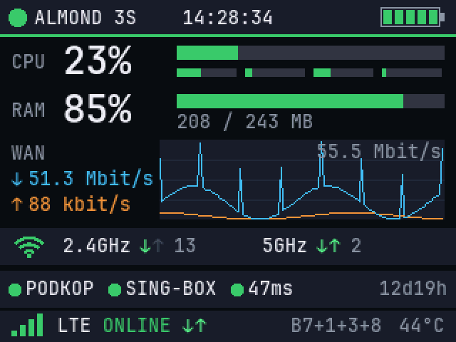
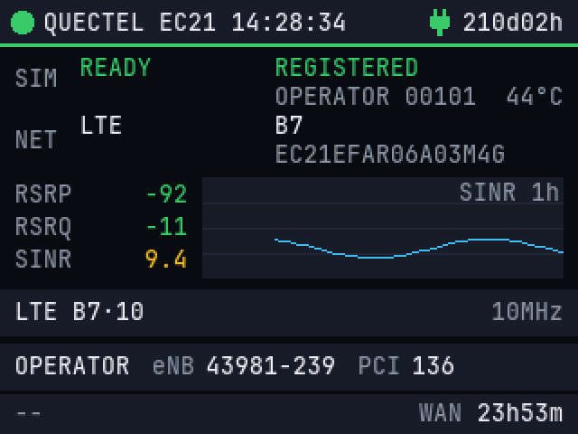
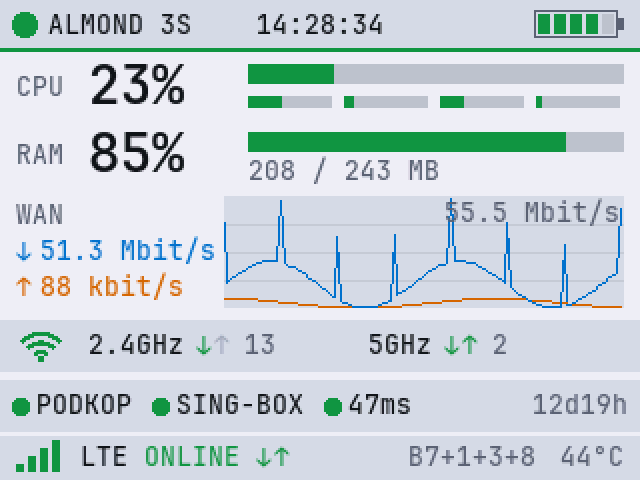
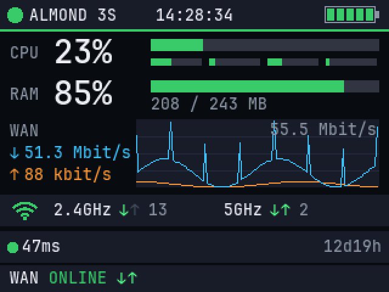

# Almond 3S LCD

Status screen for the built-in 2.8" touch display of the Securifi Almond 3S on OpenWrt. One command to install.

Экран состояния для Securifi Almond 3S на OpenWrt: загрузка CPU и памяти, скорость и график WAN, Wi-Fi, батарея, состояние podkop и встроенного модема.

| Главная | Модем | Светлая тема | Без VPN и модема |
|---|---|---|---|
|  |  |  |  |

Картинки построены самой программой на условных данных (`src/preview.c`).

## Установка

Выполнить на роутере по SSH:

```sh
wget -qO- https://raw.githubusercontent.com/delormemsc/almond3s-lcd/main/install.sh | sh
```

Удаление:

```sh
wget -qO- https://raw.githubusercontent.com/delormemsc/almond3s-lcd/main/install.sh | sh -s uninstall
```

## Что нужно

Securifi Almond 3S (плата `securifi,almond-3s`) с прошивкой OpenWrt из таблицы. Установщик сам определяет ядро и на другой системе ничего не меняет.

| OpenWrt | Ядро | Статус |
|---|---|---|
| 24.10.5 | 6.6.119 | проверено на роутере |
| 24.10.0–24.10.4, 24.10.6–24.10.8 | 6.6.73, 6.6.86, 6.6.93, 6.6.104, 6.6.110, 6.6.127, 6.6.141, 6.6.144 | собрано из официального SDK, на железе не проверялось |
| 25.12.0–25.12.6 | 6.12.71, 6.12.74, 6.12.85, 6.12.87, 6.12.94, 6.12.112 | собрано из официального SDK, на железе не проверялось |

Официальных образов OpenWrt для этой платы нет, нужна сборка под неё. Модуль привязан к версии ядра: после смены прошивки установку нужно повторить, остальные файлы переживают `sysupgrade`.

## Как это работает

- Тап или свайп переключает страницу, удержание около секунды меняет тему.
- `PODKOP` и `SING-BOX` показываются, только если установлен podkop. В этом случае раз в минуту запрашиваются `fakeip.podkop.fyi` и `ipinfo.io`. Без podkop из внешних запросов остаётся только ping до 8.8.8.8.
- Страница модема включается для встроенного Quectel EC21 (`2c7c:0121`), данные читаются AT-запросами с порта `ttyUSB3`. Если запущен ModemManager, страница не включается, чтобы не мешать его соединению.
- `TUN` появляется, только если на роутере замечен обратный SSH-туннель. Сам туннель проект не настраивает.
- Не запускайте `gpioget` и `gpioset` на `gpiochip0`: экран перестанет работать.

## Сборка

Нужен OpenWrt SDK нужной версии для ramips/mt7621. Пример для 24.10.5:

```sh
S=/path/to/sdk; K=$S/build_dir/target-mipsel_24kc_musl/linux-ramips_mt7621/linux-6.6.119
T=$S/staging_dir/toolchain-mipsel_24kc_gcc-13.3.0_musl
export STAGING_DIR=$S/staging_dir PATH=$T/bin:$S/staging_dir/host/bin:$PATH
make -C $K ARCH=mips CROSS_COMPILE=mipsel-openwrt-linux-musl- M=$PWD/kmod modules
mipsel-openwrt-linux-musl-gcc -Os -o dist/almond-lcd-status src/almond-lcd-status.c -lm
mipsel-openwrt-linux-musl-gcc -Os -o dist/almond-lcd-at src/almond-lcd-at.c
```

## Лицензия и автор

Автор: [Andrey Delorme](https://github.com/delormemsc). Лицензия [GPL-2.0-only](LICENSE): можно использовать, изменять и распространять, сохраняя указание автора и эту лицензию. Встроенный шрифт JetBrains Mono распространяется по [SIL OFL 1.1](LICENSES/OFL-1.1.txt). Подробнее в [NOTICE](NOTICE).
